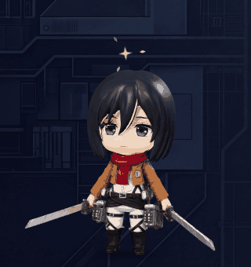
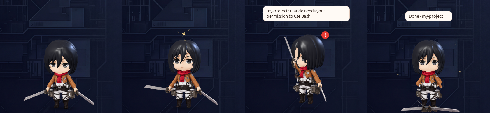
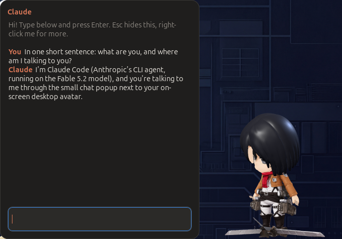
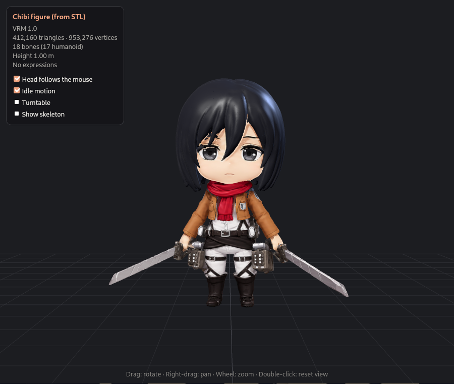

# Claude Buddy

An animated desktop avatar for [Claude Code](https://claude.com/claude-code) on Linux.

It floats on your desktop, watches your cursor, reacts to what your Claude Code sessions are doing, and opens a small chat with Claude when you click it. It can render a plain built-in 2D character or any 3D avatar in VRM format.

This is an unofficial personal project. It is not made by, affiliated with, or endorsed by Anthropic.





*Idle · Claude is working · Claude needs you · session finished.*

## What it does

- **Reacts to Claude Code.** Hooks report every session's state to the avatar: working, waiting for you (with the project name and message in a speech bubble), finished, idle.
- **Chat.** Click the avatar, type, press Enter. Answers come from headless `claude -p`, and the conversation is kept between messages and across restarts.
- **Looks at your mouse.** With a 3D model, the body turns part of the way toward the cursor and the head does the rest.
- **Actions.** Idle gestures, sparring while Claude works, a salute when a session finishes, sleeping after five quiet minutes, and a menu of actions you can trigger yourself.
- **Walks and jumps.** It strolls along the screen, dashes to the cursor on request, and can jump onto things it sees on screen: it looks for long horizontal edges (wallpaper shapes, window tops, panels) and lands on them.
- **Detachable props.** If the model has separate `BladeL` / `BladeR` meshes, the avatar puts them down before hand gestures and picks them up again for blade actions.

Also included:

- **VRM Viewer**, a small local viewer for `.vrm` and `.glb` files.
- **An experimental pipeline** that turns an uncoloured STL figure plus a few reference pictures into a textured, rigged VRM.



## No character model is included

The repository contains code only. It ships no 3D model, texture, or reference art. The screenshots show the author's own setup with a fan-made model of a character that belongs to its rights holders; that model is not distributed here. Without a model, the avatar uses its built-in 2D character, which is original to this project.

To use a 3D avatar, supply your own VRM file. Make sure you have the right to use it.

## Requirements

- Linux with an X11 session and a compositing window manager (developed on Ubuntu 25.04, GNOME 48). Wayland is not supported: the avatar relies on global pointer position, window placement and screen capture.
- Python 3 from the system (`/usr/bin/python3`) with GTK 3, cairo and WebKitGTK 4.1 bindings.
- Claude Code installed at `~/.local/bin/claude` (for the chat).

On Debian or Ubuntu:

```sh
sudo apt install python3-gi python3-gi-cairo gir1.2-gtk-3.0 gir1.2-webkit2-4.1 python3-numpy netcat-openbsd
```

`python3-numpy` is only needed for jumping onto screen elements. `netcat-openbsd` is used by the hook script.

## Install

```sh
git clone https://github.com/taghouti-org/claude-buddy.git
cd claude-buddy
./install.sh --autostart --hooks
```

- `--autostart` starts the avatar at login.
- `--hooks` adds the Claude Code hooks to `~/.claude/settings.json`. A timestamped backup of that file is written first, and existing hooks are kept.
- Run `./install.sh` with no flags to install or update only the programs.
- `./install.sh --uninstall` removes the installed files.

Everything is installed for the current user under `~/.local`. Nothing needs root.

If you prefer to add the hooks by hand, merge [`hooks.example.json`](hooks.example.json) into your settings.

## Use

Start it with `claude-buddy` or from the application menu.

| Action | Result |
|---|---|
| Click | Opens the chat. Enter sends, Esc hides. |
| Drag | Moves the avatar. The position is remembered. |
| Right-click | Menu: chat, open Claude in a terminal, new conversation, walking, jumping, actions, quit. |

From a terminal:

```sh
claude-buddy --toggle             # open or close the chat
claude-buddy --ask "question"     # send a question directly
claude-buddy --act salute         # play an action by name
claude-buddy --act walk           # take a stroll
claude-buddy --act come           # dash to the cursor
claude-buddy --act jump           # jump onto something on screen
claude-buddy --act blades         # put the props down, or pick them up
claude-buddy --2d                 # start with the built-in 2D character
```

Action names: `hop`, `spin`, `jumpspin`, `flourish`, `slash`, `guard`, `napecut`, `bladecheck`, `salute`, `scarf`, `stretch`, `nod`, `bow`, `victory`, `dance`, `sway`, `lookaround`, `punch`, `kick`, `squats`, `crossarms`, `wave`.

Binding `claude-buddy --toggle` to a keyboard shortcut in your desktop settings gives you a hotkey for the chat.

### What the moods mean

| State | Trigger | What you see |
|---|---|---|
| Working | A session submitted a prompt or is running tools | Sparring, a spinning spark overhead |
| Needs you | Claude Code sent a notification (for example a permission request) | Jumping, a red "!" and a speech bubble |
| Done | A session stopped | Salute, sparkles, "Done · project" |
| Asleep | Five minutes without activity | Head down, dimmed, floating "z"s |

### Chat limits

The chat runs `claude -p` in your home directory. Headless mode cannot show permission prompts, so actions that need approval are refused there; do those in a normal terminal session. It uses your default model and effort settings.

## Using your own 3D model

Copy a VRM file to:

```
~/.local/share/claude-buddy/avatar.vrm
```

and restart the avatar. VRM 0.x and 1.0 both load.

Optional conventions the avatar understands:

- Mesh nodes named `BladeL` and `BladeR`, each with `extras` holding `centre` and `axis` (in model space), are treated as hand-held props that can be laid on the ground.
- A bone named `Scarf` is lifted and swayed during the scarf gesture and trails when the avatar moves.

Models without these simply skip those behaviours.

## VRM Viewer

```sh
vrm-viewer path/to/model.vrm
```



Drag to rotate, right-drag to pan, wheel to zoom, double-click to reset. The side panel shows format, triangle count, bones and expressions, with toggles for head tracking, idle motion, turntable and skeleton display. You can also drop a file onto the window.

For inspecting a model at fixed angles, set environment variables before launching:

```sh
VRM_VIEW=face vrm-viewer model.vrm                              # face close-up
VRM_VIEW=upper VRM_EXTRA="&pose=armsout&blades=0" vrm-viewer model.vrm
```

Views: `front`, `back`, `left`, `right`, `top`, `q3`, `q3b`, `face`, `hips`, `upper`, `upperback`, `neck`, `neckside`, `neckback`, `handL`, `handR`. Poses: `armsout`, `armsup`, `armsfwd`, `headturn`, `headup`, `scarfup`.

## How it works

```
Claude Code session ──hook──▶ hook.sh ──▶ unix socket ──▶ claude_buddy.py ──▶ avatar window
                                          ($XDG_RUNTIME_DIR/claude-buddy.sock)
```

- `buddy/hook.sh` forwards each hook event's JSON to a user-only Unix socket. If the avatar is not running it exits silently, so it never blocks a session.
- `buddy/claude_buddy.py` is a GTK 3 program. It owns the transparent always-on-top window, the chat popup, the speech bubble, the menu, walking and jumping, and the socket.
- `buddy/web/avatar.html` renders the 3D model with three.js and three-vrm inside an embedded WebKit view, and holds all poses and animations.
- The page, the libraries and the model are served to that view from a loopback-only HTTP server on a random port. Nothing is fetched from the internet at run time.

## Privacy

- The avatar makes no network connections of its own. The chat calls your local `claude` command.
- To find things to jump on, it captures one monitor, analyses the image in memory, and discards it. Nothing is written to disk or sent anywhere. Turn this off with "Jump onto things on screen" in the menu.
- Hook events are not logged.

## The STL-to-VRM pipeline (experimental)

`pipeline/` holds the scripts used to turn a single fused, uncoloured STL figure into a textured, rigged VRM using reference pictures of the same figure from several angles. They are research scripts, not a finished tool: they assume a particular chibi figure's proportions, expect specific file names, and need editing for any other model. See [`pipeline/README.md`](pipeline/README.md).

## Limitations

- X11 only.
- A live 3D avatar uses a noticeable amount of CPU: roughly 6–17% of one core on integrated graphics, depending on model size. The 2D character uses almost none.
- A drop-down terminal or other always-on-top window can cover the avatar.
- Chat replies appear all at once and as plain text.

## Licences

- This project: MIT, see [`LICENSE`](LICENSE).
- `vendor/lib` contains [three.js](https://github.com/mrdoob/three.js) and [three-vrm](https://github.com/pixiv/three-vrm), both MIT. Their licence files are alongside them.

"Claude" is a trademark of Anthropic. This project uses the name only to describe what it works with.
